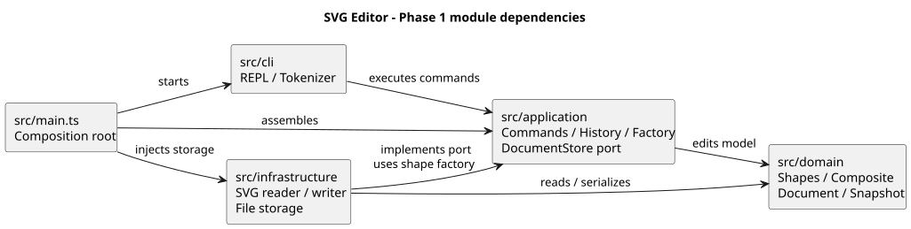

# Lab1 Phase 1：架构方案、过程记录与最终自查

本项目使用 TypeScript 和面向对象设计实现命令行 SVG 编辑器。课程要求的 19 个命令入口、六种内置图形、Composite 容器、SVG 文件读写及 undo/redo 均已实现。最终自动验收为 63 项通过，详细证据见“质量保证手段”；SVG 导入范围和结构操作的边界见下文。

## 架构方案

### 模块划分

| 模块 | 职责与主要对象 |
| --- | --- |
| src/cli | Cli 负责 REPL 与输出，Tokenizer 负责引号、注释和分词；不包含图形规则 |
| src/application | 具体命令、CommandDispatcher、EditorSession、CommandHistory；ShapeFactory/ShapeDefinition 统一构造；DocumentStore 定义存储接口 |
| src/domain | Shape 和六种图形类、Geometry、SvgDocument、DocumentSnapshot、SvgPresentation；维护图形行为和文档约束 |
| src/infrastructure | SvgReader、SvgWriter、XmlEncoder、SvgFileStore；隔离 XML 库与磁盘 IO |
| src/main.ts | 组装会话、工厂、存储与 CLI，负责依赖注入 |




### 设计模式的选择

| 模式 | 在代码中的落地 | 选择理由 |
| --- | --- | --- |
| Command | commands/Command 为统一协议，各命令类实现 execute；CommandDispatcher 创建并执行命令 | 将输入语法与业务操作分离，为其他交互入口保留应用操作 |
| Composite | Shape 统一图形操作，Group 递归组合子图形并委派 move/scale，文档统一删除子树 | 容器与叶子共享操作语义，命令不按图形种类分派 |
| Factory | ShapeFactory 的六类型注册表与 ShapeDefinition，供 CLI 和 SVG Reader 共用 | 避免读入和新建使用两套构造规则 |
| Memento + 命令包装 | UndoableCommand 保存编辑前后 DocumentSnapshot，CommandHistory 保存可撤销命令对象；各类型多态 clone | 一次撤销恢复完整父级、顺序、样式和文字，不靠反向算术；重做恢复结果快照而非重新执行操作 |

### 依赖方向规则与理由

| 模块 | 允许依赖 | 理由 |
| --- | --- | --- |
| cli | 本层、application、Node readline/stream | 只处理交互，将业务交给命令；不直接操作领域图形或文件 |
| application | 本层、domain | 编辑流程复用领域行为；通过 DocumentStore 接口使用存储，不绑定具体 XML 或文件实现 |
| domain | 本层 | 核心模型可脱离终端、Node IO 与 XML 库运行和测试 |
| infrastructure | 本层、application、domain，以及 XML/Node IO | 实现应用层存储接口，消费共用工厂，并把 XML 转换为领域对象 |
| main | 所有模块 | 仅负责组装具体依赖，不承载业务规则 |


### 变化点假设

1. **图形类型增加**：通过 Shape 多态和集中定义减少分散判断；新类型仍需注册。
2. **交互方式增加**：CLI 仅处理交互，命令与会话可供未来 GUI/agent 复用。
3. **格式或存储方式变化**：DocumentStore 隔离磁盘与 SVG；目前只有 SvgFileStore 实现。
4. **大文档与长历史**：快照内存随文档和历史长度增长。目前优先可靠恢复，不设历史上限；规模扩大后再评估容量限制或增量历史。
5. **完整 SVG 支持**：目前按六种图形和明确展示属性处理；不认识的内容拒绝读取。后续可扩展导入定义，当前不静默丢弃未实现内容。

### 明确的实现约定与范围

- group 至少选两个不同节点，按原树前序保序；拒绝同时选择祖先和子孙。新组位于最近公共父级、第一个选中节点所在分支之前。空的原父容器保留。
- ungroup 依需求拒绝根级容器；嵌套组的子节点按序提升并占据组的位置。它不是撤销分组，不恢复原来的不同父级或交错顺序。
- 普通 g 的样式遵循 SVG 继承，不强制覆盖子节点显式样式。
- 导入 transform 原样保留，编辑局部几何坐标。解组移除组样式和变换，重新归属不补偿父级变换；不宣称屏幕外观保持。
- canvas 只给宽度时保留现有高度；修改宽高不缩放图形，viewBox 重置为 0 0 新宽 新高。
- read 成功建立默认保存路径，显式 save 成功后更新当前路径；无参数 save 使用该路径。init 成功后清空路径。help 可在尚无文档时查看。
- 元素计数包含全部图形和 g，不包含根 svg。课程原版两节点流程图为 8 个元素；本项目额外带 marker 的 groups 示例为 9 个。最初分析的误计数已在最终过程记录中纠正。
- 导入支持六类图形、命名空间、实体、CDATA、px/数字长度和展示属性；不支持 path/use、tspan、CSS style、百分比/其他单位及 DOCTYPE，遇到时保留原文档并报错。
- box 属后续插件阶段；本阶段 create box 按要求报未知类型。data-kind=box 的 SVG 作为普通 g 降级读取。

## 过程记录

这次作业我采用了分步开发的方式，先和ai梳理需求、建立项目骨架，再逐步加入图形编辑、容器、撤销重做和SVG读写。每完成一部分就检查结果并提交Git，而不是一次性生成全部代码。下面记录几次对实现影响比较大的讨论和调整。

### 1. 先解决“怎么看到画布”的问题

刚开始时，我不清楚命令行编辑器的画布在哪里。第一版虽然能通过 `tree` 查看矩形的数据，但看不到实际图片。后面经过询问后了解程序负责维护图形并生成SVG，浏览器负责显示。因此，我把 `save` 提前到其他图形功能之前实现，让我在过程中可以在浏览器直接查看效果，再继续扩展。这样后面的修改除了检查属性，也有了直观的对照。

### 2. 把容易误解的规则变成检查点

在和ai讨论实现细节时，我发现不能只根据命令名称理解功能。例如，`scale` 不只是放大尺寸，还要同时缩放位置；`#ffffff` 是颜色，不能被当作注释；文字应放在SVG的子文本中，而不是写成属性。我把这些规则与作业原文对应起来，并让它们体现在测试中。也就是说，ai生成的代码即使能够运行，也仍然需要核对具体语义。

### 3. 为复杂操作选择可靠的撤销方式

对于撤销，我更关心删除和分组后能否完整恢复父级、子图形和顺序，而不只是把坐标改回去。讨论后采用了Command配合文档快照的方案：每条编辑命令保存前后状态，撤销和重做恢复相应快照，这样也避免了用反向缩放恢复时的浮点误差。

### 4. 纠正ai对元素数量的误判

ai最初认为作业原版流程图有9个元素，并怀疑示例计数有误。最终验收时，新增测试没有通过；重新逐项核对后确认，实际应为外层组1个、两个节点各3个、连线1个，共8个。程序原本的输出正确，需要修正的是测试预期。额外带标记点的自建示例才是9个。所以，ai给出的分析和测试预期也需要检查，不能为了让测试通过而直接修改正确的程序。

## 一致性自查

### 1. 实际模块与方案是否一致？

一致。最终目录为 cli、application、domain、infrastructure 及 main；同一模块内部增加 commands、shapes 子目录，未新增架构层。

实现过程的修订均已记录：先做 save 以便可视化，再扩展图形；随后加入容器与历史；最后把工厂 switch 改为 CLI/读取共用的注册定义。新增 ShapeDefinition、SvgPresentation、DocumentSnapshot 属于原有模块职责，未改变依赖方向。

生产类均一类一文件且类名与文件名一致；字段保持封装。Command、DocumentStore 为接口文件，main 为组装入口，不要求伪造类。

### 2. 是否违反依赖规则？

未发现违规，对全部源码静态 import 执行架构测试。代表性证据：

- Cli -> CommandDispatcher：交互层只依赖应用层。
- UndoableCommand -> DocumentSnapshot：应用层使用领域快照。
- SvgFileStore -> DocumentStore / SvgReader / SvgWriter：具体存储实现依赖接口与本层实现。
- SvgReader -> ShapeFactory / SvgDocument：读取复用应用工厂并构建领域文档。
- domain 内只有本层 import，没有 node:fs、readline 或 XML 库。
- CommandDispatcher 和 ShapeFactory 是仅有的两个名字分派点；未出现业务代码到处 switch(tag)。

## 质量保证手段

我采用自动检查、示例回放和输出对照相结合的方式判断完成情况，而不是只依据程序能启动或某个示例能运行。

### 自动检查与异常情况

项目提供以下检查命令：

```powershell
npm ci
npm run typecheck
npm test
```

开发过程中由AI协助执行了这些检查，最近一次结果为 **63 项测试通过、0 失败**，类型检查和构建也通过。测试重点包括：

- **功能与数据**：六种图形的创建、几何属性修改、容器嵌套、分组、删除及同级顺序。
- **历史恢复**：每种编辑的撤销重做、连续多步恢复、新编辑清空 redo，以及文档操作后的历史屏障。
- **失败处理**：重复 id、非法参数、循环嵌套、文件读写失败后，文档和历史是否保持不变。
- **文件往返**：保存后重新读取，检查层级、属性、文字、默认路径和自动补 id 是否正确。

我认为这些异常情况比单独验证“成功创建一个矩形”更能反映实现是否可靠。不过，测试也是在 AI 协助下编写的，测试数量本身不能证明需求已经被正确理解，仍需与作业原文对照。

### 示例输出与外观对照

项目回放了作业中的完整会话和中文流程图，保存了[会话输出](acceptance-session.txt)与[流程图输出](acceptance-flowchart.txt)。我在文档中保留这些结果，便于将命令、属性变化和最终文件对应起来。完整会话中故意触发的非法分组、保存后撤销错误，与程序意外失败应区别看待。

已有的浏览器预览由 AI 协助完成，检查了[中文流程图](../examples/assignment-flowchart.svg)、[图层调整前](../examples/layers-before.svg)与[调整后](../examples/layers-after.svg)的遮挡关系，以及[外部 SVG 编辑后](../examples/imported.svg)的字体和变换保留情况。这些结果可以作为外观检查的依据；我自己的人工验收记录只填写实际执行过的操作和观察结果。

### 架构检查与适用范围

除了功能，我还将模块依赖、一类一文件、类名与文件名一致等要求纳入架构检查，并在“一致性自查”中列出代码依据。这样可以检查实现是否仍符合最初的模块方案，避免功能增加后出现反向依赖。
