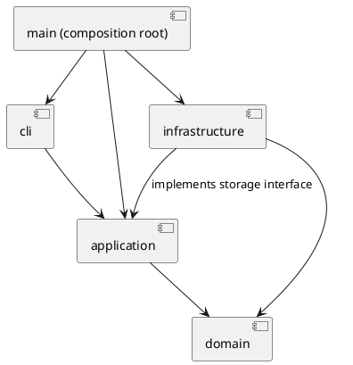

# 架构方案与开发记录

## 架构方案

### 模块划分

以下是目标结构；当前已建立 cli、application、domain 和启动入口，infrastructure 随文件读写功能添加。

| 模块 | 职责 |
| --- | --- |
| src/cli | REPL、分词、显示输出，不包含图形规则 |
| src/application | 命令执行、编辑会话、历史管理，以及文件存储接口 |
| src/domain | 图形类、文档树、id 唯一性与层级约束 |
| src/infrastructure | SVG 解析、序列化和文件读写，实现 application 的存储接口 |
| src/main.ts | 组装对象和依赖，启动程序 |

组件图（PlantUML 源码）：

### 设计模式的选择

- Command：将用户操作封装为命令对象。当前已有 HelpCommand、InitCommand、CreateCommand、TreeCommand，由 CommandDispatcher 统一创建并执行；可撤销协议和历史管理尚未实现。
- Composite（计划）：Shape 抽象类统一图形操作，Group 管理子图形并递归委派操作。
- Factory：ShapeFactory 集中完成类型名到图形类的创建映射，当前仅注册 rect。
- Memento（待验证）：优先评估快照式撤销，用空间换取结构操作的恢复可靠性。

仅允许在命令分发与图形工厂中按名字分派。这两处为显式待重构点；当前已集中到 CommandDispatcher 与 ShapeFactory，其他业务代码不按图形类型名分派。

### 依赖方向规则

- cli 可依赖 application；不直接操作领域对象或文件系统。
- application 可依赖 domain；不依赖 cli 或具体 infrastructure 实现。
- domain 不依赖其他业务层，也不执行终端或文件 IO。
- infrastructure 可依赖 domain，以及 application 定义的存储接口。
- main 为组装入口，可依赖上述模块。
- 当前使用 Node.js readline 与流接口的代码只出现在 cli 和入口。

### 变化点假设

1. 新图形类型：通过图形多态和集中工厂降低修改范围；本阶段不实现插件加载器与 box。
2. 新交互入口：命令行与应用操作分离，为未来 GUI 或其他入口保留复用空间。
3. 文件格式或存储方式：通过存储接口隔离具体 SVG 和文件 IO。
4. 撤销策略：集中于历史管理模块；先保证正确性，不提前优化为增量日志。

### 待明确的需求

- group 跨父容器时，新组的父级、插入位置与相对顺序。
- 外部 SVG 的 transform、不支持标签及其他非白名单属性的处理范围。
- 普通 g 的 set 样式采用 SVG 容器属性语义；是否有额外传播要求需核对。
- 示例保存的元素计数有不一致，以明确的计数规则和实际结构为准。

## 过程记录

### 2026-10-23：项目初始化

- 与 AI 共同阅读需求，确认本阶段实现六种内置图形，不实现 box 与插件系统。
- 用户要求分步提交；本阶段只建立骨架，验证后由用户进行第一次提交。
- 已检查本机环境：Node.js 22.14.0、npm 11.12.1、Git 2.43.0。
- 建立交互层、应用层的最小入口，先使用 help 验证 REPL，避免将全部功能一次性生成。
- 注意：当前架构图是目标方案，尚未创建的模块在模块划分中明确标注。

### 2026-10-23：最小图形模型与命令

- 确认第一次初始化提交已完成，本阶段开始时工作区干净。
- 增加封装字段的 Shape、Rect、SvgDocument；抽象基类提供类型与描述的多态接口。当前文档为平面集合，Composite 子树将在容器阶段实现。
- 增加 EditorSession、CommandDispatcher、ShapeFactory，以及 InitCommand、CreateCommand、TreeCommand。
- Cli 仅负责分词、转交命令、输出与错误边界；启动入口负责组装依赖。
- 分词器只忽略以 # 开头的整行，不截断 #ffffff；支持双引号和引号内的反斜杠、双引号转义，普通 Windows 路径反斜杠保持不变。
- 代码自查时把 CreateCommand 中固定写死的 rect 成功反馈改为通过 Shape.getType() 获取，避免扩展图形时遗留矩形专用逻辑。
- 对失败原子性采取“校验完成后再修改”：init 先构造有效文档才替换，create 先完整构造有效图形再检查并加入集合。
- 本阶段约定：画布尺寸必须为正有限数；矩形宽高非负（允许零），坐标可为负数；init 只提供宽度时高度默认 600。数字支持十进制和科学计数法，拒绝空串、十六进制与非有限数。
- 仅实现 help、init、create rect、tree [id]；容器、其他形状、编辑、历史和文件 IO 尚未完成。
- 验证：npm run typecheck、npm test 全部通过。4 组测试覆盖分词、领域约束、命令状态和真实 CLI；命令测试逐项确认 15 类失败输入不改变文档。git diff --check 通过。
- Git 只在受限环境报告用户身份与仓库所有者不同，切换正常用户环境完成检查，未修改全局 safe.directory 配置。

## 一致性自查

- 当前实际目录为目标架构的子集：cli、application、domain 已建立，infrastructure 尚未实现。
- 抽样检查新增 import：Cli 仅依赖应用层分发器，application 依赖 domain，domain 只依赖本层；未出现反向业务依赖。Shape.describe 是无 IO 的领域描述，树形连接符由 TreeCommand 负责。
- 后续每阶段复核新增依赖并记录架构修订。

## 质量保证手段

初始化阶段通过类型检查、构建和 CLI 冒烟检查。第二阶段通过 npm run typecheck 和 npm test（先编译，再运行 4 组自动测试），覆盖分词、唯一 id、尺寸约束、默认参数、创建顺序、tree 输出，以及非法命令后的状态保持。真实 CLI 子进程验证报错后继续处理、注释、颜色和 EOF。测试使用 Node.js 内置 test/assert，不新增测试框架依赖。

后续重点验证：失败时文档与历史不变、嵌套容器操作、层级与顺序恢复、历史屏障、SVG 读写往返、id 补全与冲突、典型会话回放。
