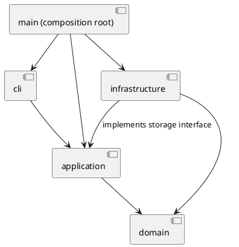

# 架构方案与开发记录

## 架构方案

### 模块划分

以下是目标结构；当前仅建立 cli、application 和启动入口，其余模块随功能逐步添加。

| 模块 | 职责 |
| --- | --- |
| src/cli | REPL、分词、显示输出，不包含图形规则 |
| src/application | 命令执行、编辑会话、历史管理，以及文件存储接口 |
| src/domain | 图形类、文档树、id 唯一性与层级约束 |
| src/infrastructure | SVG 解析、序列化和文件读写，实现 application 的存储接口 |
| src/main.ts | 组装对象和依赖，启动程序 |

组件图（PlantUML 源码）：

### 设计模式的选择

- Command：将用户操作封装为命令对象。当前 HelpCommand 仅验证命令对象入口；后续为编辑命令定义可撤销协议及历史管理，不能将当前接口视为撤销功能已完成。
- Composite（计划）：Shape 抽象类统一图形操作，Group 管理子图形并递归委派操作。
- Factory（计划）：集中完成类型名到图形类的创建映射。
- Memento（待验证）：优先评估快照式撤销，用空间换取结构操作的恢复可靠性。

仅允许在命令分发与图形工厂中按名字分派。这两处为显式待重构点；当前 Cli 中的 help 判断属于命令分发，后续集中至分发器。

### 依赖方向规则

- cli 可依赖 application；不直接操作领域对象或文件系统。
- application 可依赖 domain；不依赖 cli 或具体 infrastructure 实现。
- domain 不依赖其他业务层，也不执行终端或文件 IO。
- infrastructure 可依赖 domain，以及 application 定义的存储接口。
- main 为组装入口，可依赖上述模块。
- 当前使用 Node.js readline 与流接口的代码只出现在 cli 和入口。

### 变化点假设

1. 新图形类型：通过图形多态和集中工厂降低修改范围；本阶段不实现插件加载器与 box。
2. 新交互入口：命令行与应用操作分离，为未来 GUI 或其他入口保留复用空间。
3. 文件格式或存储方式：通过存储接口隔离具体 SVG 和文件 IO。
4. 撤销策略：集中于历史管理模块；先保证正确性，不提前优化为增量日志。

### 待明确的需求

- group 跨父容器时，新组的父级、插入位置与相对顺序。
- 外部 SVG 的 transform、不支持标签及其他非白名单属性的处理范围。
- 普通 g 的 set 样式采用 SVG 容器属性语义；是否有额外传播要求需核对。
- 示例保存的元素计数有不一致，以明确的计数规则和实际结构为准。

## 过程记录

### 2026-10-23：项目初始化

- 与 AI 共同阅读需求，确认本阶段实现六种内置图形，不实现 box 与插件系统。
- 用户要求分步提交；本阶段只建立骨架，验证后由用户进行第一次提交。
- 已检查本机环境：Node.js 22.14.0、npm 11.12.1、Git 2.43.0。
- 建立交互层、应用层的最小入口，先使用 help 验证 REPL，避免将全部功能一次性生成。
- 注意：当前架构图是目标方案，尚未创建的模块在模块划分中明确标注。

## 一致性自查

- 当前实际目录为目标架构的子集，尚未实现 domain 与 infrastructure，未宣称功能完成。
- Cli 依赖应用层命令，入口负责启动；目前未出现反向业务依赖。
- 后续每阶段复核新增依赖并记录架构修订。

## 质量保证手段

本阶段验证通过：npm run typecheck（类型检查）、npm run build（编译），以及 help、注释、空行、未知命令和 EOF 的管道输入冒烟检查。当前未覆盖图形编辑功能，因为尚未实现。

后续重点验证：失败时文档与历史不变、嵌套容器操作、层级与顺序恢复、历史屏障、SVG 读写往返、id 补全与冲突、典型会话回放。
