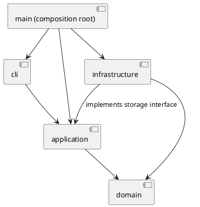

# 架构方案与开发记录

## 架构方案

### 模块划分

当前已建立 cli、application、domain、infrastructure 和启动入口。模块目录齐备，但功能仍按阶段实现。

| 模块 | 职责 |
| --- | --- |
| src/cli | REPL、分词、显示输出，不包含图形规则 |
| src/application | 命令执行、编辑会话、历史管理，以及文件存储接口 |
| src/domain | 图形类、文档树、id 唯一性与层级约束 |
| src/infrastructure | SVG 解析、序列化和文件读写，实现 application 的存储接口 |
| src/main.ts | 组装对象和依赖，启动程序 |

组件图（PlantUML 源码）：

### 设计模式的选择

- Command：将用户操作封装为命令对象。当前已有 HelpCommand、InitCommand、CreateCommand、TreeCommand、SaveCommand、MoveCommand、ScaleCommand、SetCommand、ShowCommand、GroupCommand、UngroupCommand、AddToCommand、DeleteCommand、FrontCommand、BackCommand、CanvasCommand，由 CommandDispatcher 统一创建并执行；编辑命令包装为 UndoableCommand，CommandHistory 管理撤销重做。
- Composite：Shape 抽象类统一图形操作，Group 管理子图形并递归委派操作；变换先构造全部子孙的有效计划，再整体应用。
- Factory：ShapeFactory 注册表集中完成类型到图形的构造映射，ShapeDefinition 封装 CLI 和 SVG 导入的构造规则；六种内置类型共用定义。
- Memento：DocumentSnapshot 封装私有文档副本，恢复时返回新的深拷贝；UndoableCommand 保存前后快照，以空间换取可靠恢复。各图形多态 clone，避免按类型还原对象。

仅允许在命令分发与图形工厂中按名字分派。这两处为显式待重构点；当前已集中到 CommandDispatcher 与 ShapeFactory（注册表），其他业务代码不按图形类型名分派。注册式定义改善了 CLI/读取规则的一致性，后续动态插件的发现与加载仍未实现。

### 依赖方向规则

- cli 可依赖 application；不直接操作领域对象或文件系统。
- application 可依赖 domain；不依赖 cli 或具体 infrastructure 实现。
- domain 不依赖其他业务层，也不执行终端或文件 IO。
- infrastructure 可依赖 domain，以及 application 定义的存储接口。
- main 为组装入口，可依赖上述模块。
- 当前使用 Node.js readline 与流接口的代码只出现在 cli 和入口。

### 变化点假设

1. 新图形类型：通过图形多态和集中工厂降低修改范围；本阶段不实现插件加载器与 box。
2. 新交互入口：命令行与应用操作分离，为未来 GUI 或其他入口保留复用空间。
3. 文件格式或存储方式：通过存储接口隔离具体 SVG 和文件 IO。
4. 撤销策略：集中于历史管理模块；先保证正确性，不提前优化为增量日志。

### 待明确的需求

- group 跨父容器规则已明确：最近公共父级、第一个选中分支前插入、按原树前序保序；细节见容器阶段记录。
- 外部 SVG 的处理范围已明确：保留变换与展示属性，编辑局部坐标；不支持内容拒绝读取，详见读取阶段记录。
- 普通 g 的 set 样式采用 SVG 继承，不强制传播；解组移除组样式，当前未实现外观保留式样式展开。
- 示例保存的元素计数有不一致，以明确的计数规则和实际结构为准。

## 过程记录

### 2026-10-23：项目初始化

- 与 AI 共同阅读需求，确认本阶段实现六种内置图形，不实现 box 与插件系统。
- 用户要求分步提交；本阶段只建立骨架，验证后由用户进行第一次提交。
- 已检查本机环境：Node.js 22.14.0、npm 11.12.1、Git 2.43.0。
- 建立交互层、应用层的最小入口，先使用 help 验证 REPL，避免将全部功能一次性生成。
- 注意：当前架构图是目标方案，尚未创建的模块在模块划分中明确标注。

### 2026-10-23：最小图形模型与命令

- 确认第一次初始化提交已完成，本阶段开始时工作区干净。
- 增加封装字段的 Shape、Rect、SvgDocument；抽象基类提供类型与描述的多态接口。当前文档为平面集合，Composite 子树将在容器阶段实现。
- 增加 EditorSession、CommandDispatcher、ShapeFactory，以及 InitCommand、CreateCommand、TreeCommand。
- Cli 仅负责分词、转交命令、输出与错误边界；启动入口负责组装依赖。
- 分词器只忽略以 # 开头的整行，不截断 #ffffff；支持双引号和引号内的反斜杠、双引号转义，普通 Windows 路径反斜杠保持不变。
- 代码自查时把 CreateCommand 中固定写死的 rect 成功反馈改为通过 Shape.getType() 获取，避免扩展图形时遗留矩形专用逻辑。
- 对失败原子性采取“校验完成后再修改”：init 先构造有效文档才替换，create 先完整构造有效图形再检查并加入集合。
- 本阶段约定：画布尺寸必须为正有限数；矩形宽高非负（允许零），坐标可为负数；init 只提供宽度时高度默认 600。数字支持十进制和科学计数法，拒绝空串、十六进制与非有限数。
- 仅实现 help、init、create rect、tree [id]；容器、其他形状、编辑、历史和文件 IO 尚未完成。
- 验证：npm run typecheck、npm test 全部通过。4 组测试覆盖分词、领域约束、命令状态和真实 CLI；命令测试逐项确认 15 类失败输入不改变文档。git diff --check 通过。
- Git 只在受限环境报告用户身份与仓库所有者不同，切换正常用户环境完成检查，未修改全局 safe.directory 配置。

### 2026-10-23：SVG 保存与可视化验收

- 用户希望看到画布，因而调整实现顺序：先完成 save，将内存模型转换为可在浏览器中查看的 SVG，再扩展其他图形和编辑操作。第二次功能提交已完成，本阶段开始时工作区干净。
- 新增 application/DocumentStore 存储接口，由 infrastructure/SvgFileStore 实现，main 注入分发器；应用层不导入 node:fs 或具体存储类。
- 新增 SaveCommand、SvgWriter、XmlEncoder。Shape.getAttributes 返回属性快照，Rect 多态提供自己的几何属性；修改返回的快照不影响内部状态。文件格式化、XML 转义与磁盘 IO 均在 infrastructure。
- 省略 fill 时不写出该属性，遵循 SVG 默认。XML 属性中的特殊字符和空白进行转义，非法 XML 1.0 字符拒绝输出。
- 序列化先完成，再将内容写入目标目录中的唯一临时文件，写入和关闭成功后用 rename 替换目标；失败清理临时文件并输出 cannot write file，避免直接截断旧文件。此策略不宣称提供断电恢复保证。
- 文件路径只有保存成功后才更新。init 成功会清空路径，失败不清空。当前尚无 read，因此无参数 save 可复用最近一次成功保存的路径；后续 read 成功时也需设置默认路径。
- 使用 examples/rectangles.txt 通过真实 CLI 生成 examples/rectangles.svg。浏览器截图确认左侧红色矩形位于 (30,40)、尺寸 100×60，右侧蓝色矩形位于 (160,40)、尺寸 80×60，符合命令输入。临时 HTTP 服务仅用于验收，日常直接打开 SVG 文件即可。
- 验证通过：npm run typecheck、npm test，累计 8 组测试；新增覆盖 XML 输出、缺省 fill、属性快照隔离、中文及带空格路径、覆盖旧文件、非法 XML 不破坏旧文件、临时文件清理、保存失败后默认路径及文档不变、init 路径重置与真实 CLI 保存。
- 当前未实现 read、其他图形、容器、编辑和撤销重做。IO 后禁止撤销的规则将在历史模块实现，不能把当前 save 视为 Phase 1 全部完成。

### 2026-10-23：五种叶子图形与基础编辑

- 第三次提交已完成，本阶段开始时工作区干净。新增 Circle、Ellipse、Line、Text，内置叶子类型现为 rect/circle/ellipse/line/text；g 与 Composite 留到下一阶段。
- 为避免每个图形重复实现几何校验，引入具有私有状态和行为的 Geometry 类：按各图形给定的几何属性、非负约束及坐标轴定义处理编辑。Shape 统一管理样式，具体图形通过类和多态描述自身，无按类型分派的编辑逻辑。
- NumberValue 在领域层统一数字解析，application/Arguments 复用它，避免 create 与 set 接受不同格式。没有引入 domain 对 application 的依赖。
- 新增 MoveCommand、ScaleCommand、SetCommand、ShowCommand。所有叶子支持公共样式与自身几何白名单，只有 Text 支持 text 属性；id、transform、font-size 等不在本阶段 set 白名单中。
- 明确 scale 是关于原点的几何缩放：全部位置与尺寸同乘倍率，包含直线两端点；文字只缩放 x/y，字体尺寸与描边宽度不属于要求中的几何属性，保持不变。
- 处理失败原子性时考虑了多坐标运算溢出：Geometry 先计算完整候选状态，校验有限性与尺寸约束，再整体替换。禁止逐个更新坐标后才检查后续值。
- SVG 序列化通过 getTextContent 多态获取文字，输出为子文本并转义；未将文字误存为属性，序列化中无 switch(tag)。空文字也输出合法 text 元素。
- 验证：npm test 累计 16 组检查通过，npm run typecheck 通过。新增覆盖五类移动与缩放、两端点、非正倍率、溢出回滚、属性白名单、负半径与尺寸、文字和空文字编辑、缺省样式、XML 内容转义。
- 用真实 CLI 回放 examples/shapes.txt，生成 examples/shapes.svg；XML 解析确认五个元素。浏览器验收看到矩形、缩放后的圆、有描边的椭圆、直线和包含 & 的标题，未见 XML 错误或文字截断。
- 仍未实现容器、in、分组、删除、z-order、canvas、历史及 read；这些功能按后续提交逐项推进。

### 2026-10-23：容器、嵌套与分组

- 第四次提交已完成，本阶段开始时工作区干净。新增 Group 类，工厂现已支持全部六种内置类型。
- Composite 落地：Shape 为叶子提供空子集，Group 维护子图形，递归委派移动与缩放；命令不判断图形类型。Geometry 返回先验证后执行的变换计划，Group 收集全部子孙计划成功后才统一应用，避免嵌套操作部分生效。
- SvgDocument 管理根节点、全局 id 索引、父节点索引和层级调整；getShapes 返回根节点快照，countShapes 返回含全部子孙的元素数量。分组、移动归属和解组完成后同步维护父级与索引。
- 新增 group、ungroup、addto 命令；所有 create 类型支持尾部 in 子句。文字内容本身为 "in" 时仍可正常创建。
- 对需求未明确处作出约定：group 至少选择两个不同节点，按原树前序保序，拒绝同时选择祖先与子孙。新组放在所选节点的最近公共父级，位于第一个选中节点所属分支之前；原父容器变空时保留。跨级移动使用显式几何坐标，当前不生成 transform。
- ungroup 仅允许非根级普通 g；子节点按原顺序连续占据被解散容器的位置。解组不是 undo：它不恢复分组前不同父级和交错顺序。空的嵌套组也可解散。
- 普通 g 的 set 样式保存在组上，遵循 SVG 继承，不强制覆盖子节点已有样式。解组移除组本身及其样式，不额外复制继承样式到子节点；这是当前结构操作约定。
- tree 使用 TreeRenderer 递归绘制树形连接符；show 显示真实父级。SVG 序列化递归保存子元素，无 switch(tag)。save 的元素计数修正为整棵文档树数量。
- 验证：npm test 累计 22 组检查通过，npm run typecheck 通过。新增覆盖所有类型 in、深层 Composite、空容器、溢出原子性、分组相对顺序、最近公共父级、解组位置、addto 末尾追加、循环拒绝、重复 id 和失败后索引及父级不变。
- 用真实 CLI 回放 examples/groups.txt，生成 9 元素的 examples/groups.svg；XML 解析确认元素数量，浏览器确认两个“矩形+文字”节点与连线显示正常，第二节点矩形与标签都下移 100。
- 当前未实现 delete、front/back、canvas、undo/redo 和 read；下一阶段继续补全。

### 2026-10-23：删除、同级图层顺序与画布尺寸

- 第五次提交已完成，本阶段开始时工作区干净。新增 DeleteCommand、FrontCommand、BackCommand、CanvasCommand；领域行为集中在 SvgDocument，命令仅校验参数并调用。
- delete 先定位并收集整棵子树，再摘除根节点并清理全部 id 与父级索引。可删除根级组和嵌套组，保留其他节点顺序；已删除子孙的 id 可以重新创建。
- front/back 的“前后”按视觉绘制理解：SVG 同级列表末尾最后绘制，因此 front 追加到末尾、back 插入开头。调整容器时内部子节点顺序保持原样，不能越过父级与其他层级节点混排。
- canvas 无参数只查询。带宽高参数时先整体校验，再同时更新；只提供宽度时保留现有高度。画布变小不缩放、不删除或移动任何图形，超出范围的部分按 SVG 视口显示规则处理。修改尺寸不重建文档、不清空默认保存路径。
- 质量验证：npm test 累计 27 组检查通过，npm run typecheck 通过。新增覆盖子树删除、索引清理、id 复用、容器和叶子排序、同级隔离、重复置前置后、画布内容及路径保留、无文档和 15 类非法输入，以及真实 CLI。
- 回放 examples/layers.txt，生成 layers-before.svg 与 layers-after.svg；XML 检查元素顺序从 red/blue 变为 blue/red。浏览器确认 front red 后红色覆盖蓝色，删除临时容器后导出文件只含两个矩形。
- 尚未实现 undo/redo 与 read。canvas 查询将不进入历史；canvas 修改尺寸将与 init/save/read 一起形成历史屏障，这部分留给下一阶段。

### 2026-10-23：撤销重做与历史屏障

- 第六次提交已完成，本阶段开始时工作区干净。新增 CommandHistory、UndoableCommand、UndoCommand、RedoCommand 和领域 DocumentSnapshot。
- Command 模式进一步落地：分发器把编辑命令包装为 UndoableCommand，保留统一 execute 接口；可撤销命令具备 undo/redo 行为，历史栈保存命令对象。无需在每个具体编辑命令重复历史逻辑。
- Memento 决策落实：每条成功编辑保存前后文档快照。Shape.clone 由各具体类型多态实现，Group 递归复制子图形，SvgDocument.clone 重建全局 id 和父级索引。没有 JSON 数据袋或新增 switch(tag)；快照不会与当前文档共享可变图形。
- 一条编辑命令一个单元，包含整次 group、ungroup、delete、addto、front/back。undo/redo 恢复整个对象图，精确保留缺省样式、文字内容、父级、兄弟顺序和几何值；不使用反向算术避免浮点误差，不在 redo 时重新执行原命令。
- 失败编辑恢复执行前快照，并保留 undo/redo 栈和禁止标志；专项注入“先删除子树再抛错”的失败证明了防御性回滚。
- 成功 init、save、canvas 修改尺寸清空两个历史栈并禁止 undo/redo，报 error: undo not allowed after io command；下一次成功编辑才解禁。失败编辑、失败 IO 不会解禁或清空 redo。canvas 查询及 tree/show/help 不进入历史。
- 历史恢复只替换领域文档，不改变最近成功 IO 路径。历史由 EditorSession 持有，相关命令都使用同一历史实例。read 的成功加载屏障将在读取阶段接入。
- 取舍：整文档快照适合当前教学规模，便于保证结构恢复正确性；每条记录保存前后图，内存随文档大小和历史长度增长，目前不设历史容量上限。未来大量图形/长会话可改增量快照或限制历史条数，当前不提前实现。
- 验证：npm test 累计 48 组通过，npm run typecheck、git diff --check 通过。新增 12 类编辑往返、六类多态快照隔离、失败操作不清 redo、三个 IO 屏障、重做不重复执行、部分失败回滚和真实 CLI 测试；连续八步撤销重做验证了子树删除后复用同名 id 的完整恢复。
- 回放 examples/history.txt：删除节点后 undo 恢复矩形和文字；保存后 undo 按约定报错；新的文字编辑重新解禁，随后 undo/redo 正常。examples/history.svg 为保存时的恢复结果（标签 Hello），脚本末尾的 Hello again 只在内存中，未再次保存。
- 尚未实现 read；下一阶段完成 SVG 读取、缺 id 补全和读写往返后再做最终需求验收。

### 2026-10-23：SVG 读取、自动 id 与读写往返

- 第七次提交已完成，本阶段开始时工作区干净。新增 SvgReader、ReadCommand、ReadResult，扩展 DocumentStore.read 与 EditorSession.read；XML 解析使用 @xmldom/xmldom 0.9.12，并提交依赖锁文件。
- 不用正则解析 XML 结构。查阅已安装库的类型说明后使用 onError，使 XML 警告、错误和致命错误均拒绝读取；正确处理 XML 实体、CDATA、命名空间、注释和文字内容。
- 实现两遍 id 分配：先收集根和全部子元素的显式 id 并拒绝重复，再按前序为缺失或空 id 分配 标签名+序号。自动分配避开文件后面才出现的显式 id 和根 id；id 大小写敏感。警告存于读取结果，仅当完整解析成功后输出。
- 读取先在临时文档中完成，成功后才替换当前文档、设置默认保存路径并阻断历史。文件不存在报 cannot read file；格式或不支持内容报 invalid SVG。失败时保留旧文档、路径、undo/redo 和禁止状态，不提前输出补 id 警告。
- 原工厂的 switch 改为集中定义注册表。ShapeDefinition 封装 CLI 参数与 SVG 属性的构造规则，CLI 和 Reader 共享同一个 ShapeFactory；类型名分派仍仅在命令分发与图形工厂两处，没有新增读取专用 switch(tag)。两处注册分派仍按作业要求列为后续插件化待重构点。
- 导入六种类型；数值支持十进制、科学计数法及读取时的 px 后缀，省略的几何属性默认为 0。画布省略宽高时分别采用 viewBox 尺寸，否则采用工程默认 800×600；根 svg 不计入元素数、不作为可编辑图形，但可保留并预留其 id。
- 增加封装的 SvgPresentation 保存导入展示属性：transform、字体、对齐、透明度、线型、显示属性、xml:space、preserveAspectRatio 和 data-*；根部的 fill/stroke 等也保留。白名单外内容明确拒绝，不无声丢弃。SVG 版本声明允许读取，写出时统一使用默认 SVG 命名空间和现有格式。
- 保留任意有效四数字 viewBox；canvas 改尺寸时按现有语义重置为 0 0 新宽 新高。导入 transform 原样保存，不烘焙为几何坐标；move/scale 编辑局部几何坐标。结构重挂载不补偿原父级变换；解组会移除原组上的样式和变换，这一边界不宣称为保留屏幕外观的转换工具。
- 导入展示属性随 clone 复制，撤销重做不会丢失。CLI set 白名单保持课程规定，不因导入支持 font-size/transform 而允许 set 修改这些属性。data-kind=box 在未安装插件时保留标记并作为普通 g 读入；create box 仍拒绝。
- 明确不支持 path/use 等其他类型、tspan 等嵌套文字、CSS style、百分比和非 px 长度、DOCTYPE。此范围覆盖本阶段六种内置图形和课程例子，不宣称通用 SVG 全标准兼容。
- 验证：npm test 累计 58 组通过，npm run typecheck 通过。新增覆盖六类型读入、后置 id 冲突、根 id、中文与 CDATA、空文字、前缀命名空间、px、变换与 viewBox 保留、21 类非法输入、六份已生成样例逐字往返、读取的原子性和历史屏障、中文路径与默认保存。
- 回放 examples/read.txt：自动补 rect1/g1/text1，移动矩形、撤销重做、修改标题后保存 imported.svg；再次 read 不再补 id。浏览器验收确认字体与嵌套变换保留，Read & edit 和 SVG 正常显示。脚本中两次 read 后的 undo 报错是刻意检查历史屏障。
- 命令总表的功能入口均已实现；仍需最终按需求逐项验收和文档一致性整理，不在本阶段提前打 final 标签。

## 一致性自查

- 当前实际目录与目标架构的四个模块一致；infrastructure 已实现 XML 解析、SVG 读写与磁盘保存。
- 抽样检查新增 import：Cli 仅依赖应用层分发器，application 依赖 domain，domain 只依赖本层；未出现反向业务依赖。新增 SvgFileStore 依赖 application 的 DocumentStore 接口与 domain，具体实现由 main 注入；保存命令不依赖 node:fs。Shape.describe 是无 IO 的领域描述，树形连接符由 TreeCommand 负责。
- 后续每阶段复核新增依赖并记录架构修订。

## 质量保证手段

初始化阶段通过类型检查、构建和 CLI 冒烟检查。第二阶段通过 npm run typecheck 和 npm test（先编译，再运行 4 组自动测试），覆盖分词、唯一 id、尺寸约束、默认参数、创建顺序、tree 输出，以及非法命令后的状态保持。真实 CLI 子进程验证报错后继续处理、注释、颜色和 EOF。测试使用 Node.js 内置 test/assert，不新增测试框架依赖。

后续重点验证：失败时文档与历史不变、嵌套容器操作、层级与顺序恢复、历史屏障、SVG 读写往返、id 补全与冲突、典型会话回放。
